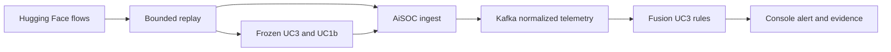

# ML detections in AiSOC

## TL;DR

- We built a Hugging Face telemetry connector, compared supervised, unsupervised and behavioural detection, and replayed real lab-captured flows through AiSOC.
- UC3, a per-source behavioural baseline, was the only detector to pass the numeric Friday entity gate. It produced 25 alerts, including 9 false alerts, at 64% precision. Its active rules are scoped to the controlled demo.
- XGBoost caught attack families it had seen and missed most examples of held-out families. Used to corroborate UC3, it identified a higher-precision subset of alerts, 10/11 versus 6/14.
- Isolation Forest missed the standalone gate. It now ranks entities for hunting. Precinct6 was more useful for auditing label shortcuts than for training a deployable detector.
- The live Patator replay scores 100,085 flows in about two minutes and confirms 15 alerts through the API. Each alert explains what changed from the source's Monday baseline.

## Architecture



1. The replay reads a projected capture slice from Hugging Face or the same prepared cache.
2. UC1b scores every flow. UC3 aggregates source behaviour per minute against Monday baselines.
3. The connector sends sampled flows and score summaries as low-severity telemetry. Labels stay local.
4. Fusion evaluates the mounted rules over the normalized event and writes one alert per accepted summary.
5. The console shows severity, the explanation, and any available triage verdict. UC2 hunting reports stay outside the alert path.

## Datasets

| Dataset | Decision |
|---|---|
| CIC-IDS2017 | Main benchmark. Captured network flows give us attack families, a benign baseline and entity-level comparisons. Published label corrections and ambiguous timestamps limit the claims. |
| Precinct6 signals | Shortcut audit. Automated correlation labels and source-specific prevalence made the apparent accuracy unreliable across organizations. |
| Advanced SIEM | Connector proof. Its small synthetic dataset is suitable for checking ingestion and classification. |
| HookProbe edge IDS | Rejected. Its verdict derives from its anomaly score, with thin features from a single edge node. |

See [dataset provenance, licensing, and sampling](docs/datasets.md).

## Connector and rules

The connector maps auth activity to `hf_auth` (OCSF Authentication, 3002) and network telemetry to `hf_network` (Network Activity, 4001). A small ingest catalogue change registers those names. Without it, the normalizer's fallback can classify the event as a finding. Supported telemetry stays below the auto-promotion severity floor and ordinarily becomes an alert only when a Fusion rule matches.

Ingestion uses `POST /v1/ingest/batch` with an ingest token. Dataset events use deterministic external IDs for repeatable ingestion. Each intentional live replay starts a new run namespace. The summary ID also becomes the hostname so the API can reconcile each output and distinguish it from existing alerts. Model values are carried under the normalized raw event and remain resolvable by rules. [Payload and rule-path notes](docs/aisoc-notes.md)

## Detectors and final roles

| Detector | Fit and evaluation | Result and final role |
|---|---|---|
| **UC1 · Precinct6 XGBoost + SHAP** | Trained on chronological malicious/benign telemetry, excluding suspicious rows from fitting. Tested against an action-and-port heuristic and held out organizations. | Heuristic AP 0.995, XGBoost AP 1.000, and zero org-holdout recall. SHAP ranked `action=block` first. The replay produced 28,510 matches and 668 alerts. Retired as a detector. |
| **UC1b · CIC XGBoost + SHAP** | Fit to early capture days using numeric flow statistics with identifiers excluded. Used a held validation day for calibration, a chronological Friday test, and separate matched family holdouts. | Friday AP was 0.864 versus 0.790 for logistic regression and 0.309 for the heuristic. It failed standalone gates. It supplies High severity when it corroborates a UC3 window. |
| **UC2 · Isolation Forest** | Fit only to benign early-day flows and calibrated on benign validation data. Compared on the same Friday flows and in a matched entity-window test. | Friday AP was 0.548. It failed standalone gates. A daily top-20 hunting report ranks sources and explains the most unusual features relative to benign medians. |
| **UC3 · Behavioural baseline** | Learned per-source medians and median absolute deviations from benign Monday minutes, with a pooled fallback. Compared with a local reproduction of AiSOC UEBA's scoring logic. | Passed the numeric entity gate in the Friday re-test. Its two exclusive severity tiers implement the only active project detector, scoped to the demo. |

In the matched **flow-level** comparisons, UC1b seen → held-out recall fell from 97.1% → 7.4% for DoS-family flows, 82.6% → 6.5% for PortScan, 99.4% → 0.0% for Patator and 95.0% → 1.5% for web attacks. This is the main reason we use it as corroboration.

## Matched entity-window comparison

Recall is measured on attack-labeled source windows. UC1b and UC2 here use diagnostic fits and matched test windows. These rows are separate from the final chronological deployment gate. Some families have very few windows.

| Attack family | Windows | UC1b seen | UC1b held out | UC2 | UC3 | UEBA-equivalent |
|---|---:|---:|---:|---:|---:|---:|
| Bot | 39 | 94.9% | 5.1% | 12.8% | 7.7% | 23.1% |
| DoS family | 6 | 100% | 16.7% | 83.3% | 83.3% | 66.7% |
| Infiltration | 3 | 66.7% | 66.7% | 100% | 100% | 100% |
| Patator | 10 | 100% | 0% | 0% | 80% | 20% |
| PortScan | 3 | 66.7% | 33.3% | 0% | 100% | 33.3% |
| Web attacks | 1 | 100% | 0% | 0% | 100% | 0% |

In the first full Friday entity test, the UEBA equivalent produced **1,511 false alerts**, UC1b **536**, UC2 **321**, and UC3 **129**. The final numeric gate allowed at most 25 false entity alerts per day and required at least 50% precision.

| Frozen Friday re-test | Alerts | False | Precision | Numeric gate |
|---|---:|---:|---:|---|
| UC1b | 216 | 202 | 6.5% | Fail |
| UC2 | 70 | 64 | 8.6% | Fail |
| UC3 | 25 | 9 | 64.0% | Pass |

UC3 detected **16/197** malicious windows. The reduced alert burden came with reduced recall. Among its 25 alerts, UC1b corroboration identified **10/11 attack-labeled alerts (90.9%)**, compared with **6/14 (42.9%)** without corroboration. These are small subsets of an already inspected day. [Full evaluation](docs/evaluation.md)

## Live demo

From this contribution directory, run `./demo/preflight.sh`, then:

```bash
./demo/run_demo.sh patator --source cache
```

The wrapper mints missing credentials quietly. The terminal shows suspicious sources, the corroboration wait, and console links. Open a High alert to see the raw `top_reasons` and `corroborated_by` fields. The rehearsal took about two minutes. The [presenter guide](docs/demo-script.md) has the walkthrough and [local evidence](docs/demo-evidence/walkthrough.md).

The earlier Day 6 replay reconciled **38/38** summaries. Deterministic triage left **30/30** attacks in review, marked **7/8** benign alerts likely benign, and auto-closed **zero**. These counts describe fallback behaviour. The [investigation check](docs/demo-evidence/walkthrough.md) records the separate local AI test.

## Limitations

- Precinct6 labels reflect automated vendor correlation. High pooled AP did not carry over to organization holdouts.
- The CIC capture clock is ambiguous. The hour correction gives useful operational ordering, but full monotonicity validation failed. Friday was examined in earlier rounds, so the preregistered re-test is weaker evidence than a fresh day.
- Monday's infrastructure allowlist includes `192.168.10.8`, a simulated lateral-movement source later in the week. Some real attack-labeled windows were suppressed. Likely infrastructure roles are unverified.
- The local 3B model did not supply verdicts in the Day 6 test. The console evidence uses the built-in fallback and confidence details.
- The demo sends up to eight telemetry flows per capture minute while scoring every flow. The console alert count describes summary events, not full flow ingestion.
- Fusion uses a read-only ruleset mount. The native build failed on PyPI timeouts while retrieving Poetry.

## Findings about AiSOC

- Active rules created with the Rules API matched the positive control when executed on demand. Streaming Fusion reads tenant settings for loaded rules and skipped the new body. [Upstream issue draft](docs/upstream-issue-rules-api.md)
- Codespaces required a local Kafka memory-limit reset after a cgroup v2 threaded-mode error, and ACCEPT forwarding on all three installed iptables backends. Kafka also logged ZooKeeper `NodeExists` after a restart. [Setup and recovery](docs/codespaces-fixes.md)
- Pulling a moving image tag via `make up` replaced a locally built ingest image. Keep `AISOC_PULL_POLICY=never` after obtaining the base images and installing the local build.

## Reproduce on a fresh Codespace

Open the fork on `hf-ml-detections`. From the repository root, use the exact [Codespaces bootstrap and mount commands](docs/codespaces-fixes.md#fresh-codespace). The demo requires the original frozen UC1b binary, which is kept local with the data artifacts. Restore it from the original Codespace before running preflight. The replay verifies its digest against the committed model version and will reject a different file.

```bash
cd contrib/hf-ml-detections
./demo/run_demo.sh --prepare
./demo/preflight.sh
./demo/run_demo.sh patator --source cache
```

Preparing the cache reconstructs the Monday baselines from the pinned capture. It leaves the UC1b model, thresholds and preregistration untouched.

## Next steps

- Evaluate the frozen UC3 policy prospectively on an independent capture with trusted timestamps.
- Review allowlisted hosts with a lab owner and measure both suppressed attacks and preserved workload on a fresh day.
- Collect analyst-verified Precinct6 labels and reserve complete organizations for an independent evaluation.
- Add a tenant-isolated end-to-end test for the Rules API streaming path and validate the native Fusion build in CI.

## Appendix · Evidence behind the headline figures

| Headline | Committed source |
|---|---|
| Precinct6 AP, organization recall, SHAP rank, Day 3 matches and alerts | [Shortcut audit](docs/evaluation.md#uc1--precinct6-shortcut-audit), [UC1 metrics](ml/uc1_xgboost/metrics.json), [SHAP plot](ml/uc1_xgboost/shap-top15.png) |
| UC1b Friday AP and matched seen/held-out flow recall | [Chronological test](docs/evaluation.md#chronological-unseen-label-test), [matched flow comparison](docs/evaluation.md#matched-family-generalization-comparison), [UC1b metrics](ml/uc1b_xgboost_cicids/metrics.json) |
| UC2 Friday AP and top-20 hunting | [Isolation Forest metrics](ml/uc2_iforest_cicids/metrics.json), [hunting evidence](docs/evaluation.md#corroboration-and-hunting) |
| First Friday false alerts and per-family matched entity recall | [First entity results](ml/uc3_behaviour_cicids/metrics.json), [matched source-window holdouts](docs/evaluation.md#matched-source-window-holdouts) |
| Final gate thresholds, alert counts, precision and UC3 recall | [Frozen configuration](ml/uc3_behaviour_cicids/prereg_v2.json), [Friday re-test metrics](ml/uc3_behaviour_cicids/friday_v2.json) |
| Booster precision, 38/38 replay and deterministic triage outcomes | [Day 6 evaluation](docs/evaluation.md#day-6--roles-and-controlled-replay) |
| Patator scored flows, alerts and runtime | [Rehearsal transcript](docs/demo-evidence/patator.txt) |

Run `python3 demo/check_report.py` from this directory to check the deck's recorded figures against the evidence at their displayed precision.
