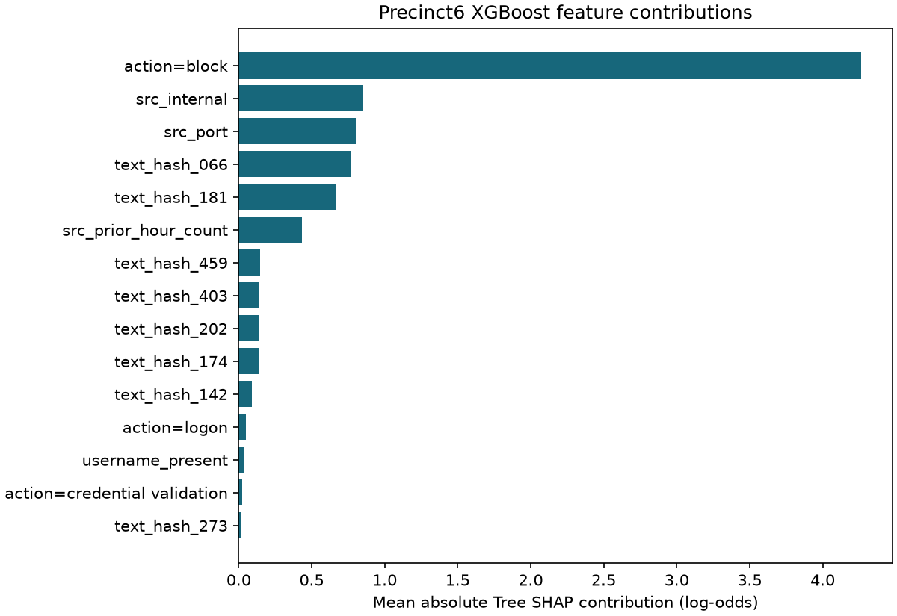

# Detection evaluation

## UC1 — Precinct6 XGBoost

### Population and scope

A remote projection of `stream_name` and `label_binary` scanned all 2,011,674
rows of the pinned main signals parquet. The VPC stream contains **0 benign,
15,063 suspicious, and 4,156 malicious** rows. The local sample contains
13,549 suspicious VPC rows and all 4,156 malicious VPC rows. No supplemental
benign sample was possible. It is a dataset artifact under WitFoo's automated
correlation labels. VPC flows are valid network telemetry and remain
eligible for ingest and separate diagnostic scoring.

| Full local sample label | Authentication | Network excluding VPC | VPC | Skipped |
|---|---:|---:|---:|---:|
| Benign | 1,677 | 5,370 | 0 | 89,089 |
| Suspicious | 106 | 82,420 | 13,549 | 61 |
| Malicious | 16 | 3,525 | 4,156 | 31 |

The sample's fixed row IDs also recovered 200,000 values each for `org_id`
and `message_sanitized`. The remote parquet reader transfers the selected
column chunks of row groups that intersect these IDs, and discards other
rows in memory. It wrote only the sample rows, adding 6.7 MB locally.

### Chronological results

The first cut used the entire sample's chronological quantiles. Its
headline test window contained 26 rows and zero positives, so ranking,
recall, and precision were unmeasurable. The reported split uses
chronological quantiles of the eligible mapped non-VPC benign/malicious
cohort. It contains 7,411 train, 1,588 validation, and 1,589 test rows.
Validation begins at 03:44:24 UTC and test at 04:17:16 UTC on July 27, 2024.
The same time boundaries apply to separate suspicious and VPC scoring.
Choosing this cohort after checking coverage makes the result exploratory.

| Model | Test PR-AUC (AP) | ROC-AUC | Precision | Recall | F1 | TP / FP / FN / TN |
|---|---:|---:|---:|---:|---:|---|
| Action and port heuristic | 0.9953 | 0.9970 | 1.0000 | 0.9940 | 0.9970 | 333 / 0 / 2 / 1,254 |
| Logistic regression | 1.0000 | 1.0000 | 1.0000 | 0.9970 | 0.9985 | 334 / 0 / 1 / 1,254 |
| XGBoost without explicit source fields | 1.0000 | 1.0000 | 1.0000 | 1.0000 | 1.0000 | 335 / 0 / 0 / 1,254 |
| XGBoost with stream, message type, vendor and product | 1.0000 | 1.0000 | 1.0000 | 1.0000 | 1.0000 | 335 / 0 / 0 / 1,254 |

XGBoost recovered one extra positive over logistic regression and two over
the heuristic at their validation-selected operating points. The source
ablation changed neither test errors nor ranking at displayed precision.
That leaves indirect source proxies possible. In particular, the action
alone does almost all the work for the heuristic.

The main threshold is **0.4472928047180176**, chosen to maximize validation
F1 under a 500-per-10,000 alert budget standardized to 0.38% prevalence.
The validation estimate at that point was 38 alerts per 10,000 binary
events. Main test confusion matrix in `[[TN, FP], [FN, TP]]` order is
`[[1254, 0], [0, 335]]`. Precision was 100% on the observed 21.08% headline
test prevalence. It also standardizes to 100% at both the requested 3.86%
sample prevalence and the 0.38% population prevalence, because observed FPR
was zero. These are point estimates. The rule-of-three upper FPR bound for
1,254 negatives is approximately 0.24%, which would put population precision
near 61% at the observed recall. Prevalence adjustment also assumes the
class-conditional error rates transfer to the population.

### Families and organization holdouts

| XGBoost test family | Binary rows | Malicious | PR-AUC (AP) | ROC-AUC | Precision | Recall | F1 | Threshold matches |
|---|---:|---:|---:|---:|---:|---:|---:|---:|
| Authentication | 302 | 2 | 1.000 | 1.000 | 1.000 | 1.000 | 1.000 | 2 |
| Network excluding VPC | 1,287 | 333 | 1.000 | 1.000 | 1.000 | 1.000 | 1.000 | 333 |
| VPC, diagnostic | 3,563 | 3,563 | — | — | — | 1.000 | — | 3,563 |

The pooled mapped binary diagnostic has 5,152 rows and 3,898 positives.
The VPC row has no benign denominator, so it cannot measure discrimination,
false-positive rate, or useful precision.

| Organization omitted from training and validation | Held test rows | Malicious | PR-AUC (AP) | ROC-AUC | Recall |
|---|---:|---:|---:|---:|---:|
| ORG-0001 | 13 | 0 | — | — | — |
| ORG-0003 | 1,178 | 2 | 0.0017 | 0.479 | 0 |
| ORG-0004 | 60 | 0 | — | — | — |
| ORG-0005 | 338 | 333 | 0.9852 | 0.500 | 0 |

ORG-0005 scored every held row identically. Its AP simply reflects the high
positive fraction. Neither holdout containing malicious rows detected one
at its threshold.

### Suspicious rows and false positives

| Suspicious test family | Rows | At or above threshold | Median score |
|---|---:|---:|---:|
| All | 24,660 | 24,617 | 0.99937 |
| Authentication | 14 | 10 | 0.80226 |
| Network excluding VPC | 13,206 | 13,206 | 0.99952 |
| VPC | 11,396 | 11,396 | 0.99506 |
| Skipped by mapper | 44 | 5 | 0.00210 |

Suspicious rows are unresolved and excluded from binary precision. The
100% alert tendency in each network slice shows that the threshold's
validation alert budget does not describe a workload with suspicious
telemetry included. There were no observed headline false positives to
rank. The 20 highest-scoring benign events were all authentication records:
9 `auth_success` rows with blank vendor, 8 Microsoft `account_logon` rows,
and 3 Microsoft `4768` Kerberos rows. Their scores ranged from 0.0116 to
0.0961, below threshold. The rule documents two plausible false-positive cases: a routine
firewall block and a benign batch job generating a burst.

The largest global contribution was `action=block`.



The plot uses a fixed sample of 700 headline test events. Contributions are
in log-odds. The action signal, organization holdout collapse, the short
observation window, and the single-class VPC stream limit claims about
generalization. IP history comes from the sampled stream and therefore
does not estimate the volume in the original event feed. No independent
analyst labels were available for estimating field performance.

Reproduce with the contribution venv:

```bash
python ml/uc1_xgboost/source.py population
python ml/uc1_xgboost/source.py recover
python ml/uc1_xgboost/train.py
python ml/uc1_xgboost/score.py
```

Metrics and the figure are checked in. Model and encoder files, row-level
scores, and source data remain under the ignored `data/` directory.

### Live replay and analyst evidence

The native `det-hf-ml-002` rule matches model version
`uc1-xgb-d1dda19f1ae9` and scores at or above the validation threshold.
Its severity is High. No ATT&CK technique is assigned because the binary
score does not identify a particular technique. The local read-only Fusion
mount loaded both this rule and the existing control. Recreating Fusion used
the existing image. Retraining requires checking the new model digest and
validation threshold before updating the rule.

The batch API accepted all 29,768 mapped test-window events with zero
rejections. The score ledger records 28,510 expected event matches,
including 3,898 malicious and 24,612 suspicious, and zero benign. These are
offline expected matches before Fusion deduplication. The live replay is
a stress test of the integration. Its 95.77% match rate is far above the
binary validation workload estimate.

Open alert `/alerts/7c097e38-45b0-5129-bb5d-2def4aa5425b` in the signed-in
console and select **Raw**. The alert detail API returned the following
content. The console renders **Raw Event Data** as JSON. Open the serialized
`raw_data` and look under its nested `raw_event` for:

```text
ml_xgb_score: 0.9992741942405701
ml_xgb_top_features: action=block (+4.561); text_hash_066=1 (+0.887); src_port=55168 (+0.864)
```

The browser presents this in the raw event section. The three contributions
show which inputs moved this model score and do not establish their
causal role in the incident.

Fusion committed through Kafka offset 39,780 with zero lag. The replay
began at offset 10,012. The alert store held 668 distinct rule alerts and
exactly 28,510 occurrences after summing each alert's recurrence count.
This reconciles all expected event matches. Repeat events contribute to
existing alerts. Fusion caps the stored source-event ID array for each
alert, so those arrays held only 16,590 IDs in aggregate.
See `services/fusion/app/services/alert_sink.py` for the occurrence rollup
and source-ID cap.

The authenticated alerts search for `det-hf-ml-002` rose from 0 to 668
distinct alerts. GET detail for each alert joined all 668 representative
event IDs to the scoring ledger with the same model version, score and
source label. There were 181 malicious, 487 suspicious and zero benign
representatives. Precision among the binary-labeled representatives was
100% (181 of 181). Only 27.1% of all representatives were labeled malicious,
and the rest were unresolved suspicious. Across all 28,510 event matches,
the malicious share was 13.7%. Neither share is ground-truth precision.

Workspace disk finished at approximately 3.0 GB free. The dangling-image
prune reclaimed about 1.38 GB. Fusion used the existing image and mount.
