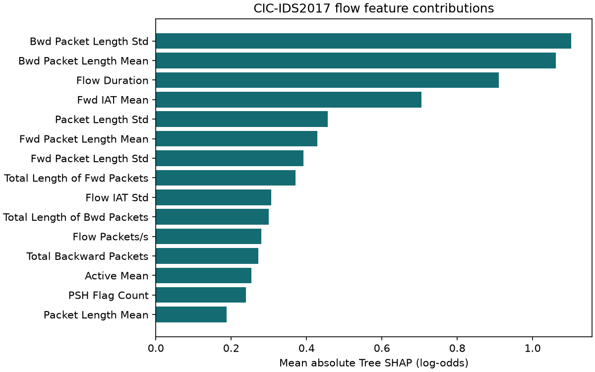

# Detection evaluation

## UC1 — Precinct6 shortcut audit

UC1 reproduced WitFoo's automated correlation verdicts on a narrow held-out
cohort. The action-and-port heuristic reached **AP 0.9953** versus **1.0000**
for XGBoost. Tree SHAP ranked `action=block` first. Both organization
holdouts with malicious examples had **zero recall** at their independently
chosen thresholds. The full VPC stream had **zero benign**, **15,063
suspicious**, and **4,156 malicious** rows.

The Day 3 replay matched **28,510 of 29,768** flows (95.77%) and produced
668 distinct alerts. The representative labels were 181 malicious and 487
suspicious (72.9%). This volume made the threshold unsuitable for deployment.
The apparent 100% precision among binary-labeled representatives excluded
suspicious rows and used automated labels.

Retraining without action, source port, or destination port on the same
source-agnostic splits still yielded pooled AP **1.0000** and recall
**99.70%**. The two positive-support organization holdouts still had zero
recall, with AP **0.0017** and **0.9852**. The latter matches its almost
all-positive base rate. Removing the explicit inputs left other proxies such
as sanitized message tokens and aggregate flow patterns available.

Together the evidence indicates that the labels largely encode firewall
decisions and source or organization context. It supports an audit of
WitFoo's verdicts rather than a claim that the classifier learned attack
behavior. A deployable evaluation would need independently analyst-verified
positives and negatives, representative benign traffic within each source,
a prospective organization holdout, and per-organization calibration
against explicit alert budgets.

The original chronological result and family metrics are in
[metrics.json](../ml/uc1_xgboost/metrics.json). The
[ablation](../ml/uc1_xgboost/shortcut-audit.json) and
[SHAP plot](../ml/uc1_xgboost/shap-top15.png) preserve the audit evidence.

Rule `det-hf-ml-002` is disabled in the generated YAML and removed from the
compiled and mounted corpora. After Fusion restarted, three fresh
above-threshold events were accepted with zero rejections (request
`req-1795356667957118960`). Fusion reached zero Kafka lag at offset 39,783.
The alerts API count remained **668 → 668**. The historical reviewer alert
is still available at `/alerts/7c097e38-45b0-5129-bb5d-2def4aa5425b`.

## UC1b — CIC-IDS2017 supervised evaluation

The primary generalization result is leave-one-attack-family-out. This
experiment uses a fixed, separately stratified split by day and original
label. The held family is excluded from fitting and threshold selection.
Each held test compares that family with the same benign reference flows.
The separate chronological run trains Monday through Wednesday, validates
Thursday, and tests Friday. All original Friday attack labels (Bot, DDoS,
PortScan) are absent from training. Wednesday does contain related
non-distributed DoS examples. Friday is an unseen-label test with a day
shift. The [label-by-day census](datasets.md#cic-ids2017-flow-subset)
describes the overlap.

The projected sample had 78,183 rows and no NaN or infinite numeric inputs.
Cleanup discarded 6,707 rows with conflicting labels on identical feature
vectors and 8,051 repeated vectors, leaving 63,425 rows. This is a
conservative feature-equivalence test. Some repeated observations may be
legitimate distinct flows.

The simple heuristic scores unusually high flow duration, byte rate, or
packet rate against benign training quantiles. Logistic regression uses
log-transformed features with training-only imputation and robust scaling.
XGBoost uses the same 25 numeric flow statistics. For all three, the
threshold maximizes validation F1 subject to at most 300 alerts per 10,000
validation flows.

### Chronological unseen-label test

| Model | AP | Precision | Recall | F1 | Alerts per 10k | TN / FP / FN / TP |
|---|---:|---:|---:|---:|---:|---|
| Heuristic | 0.3087 | 0.0682 | 0.0027 | 0.0052 | 136 | 8,356 / 164 / 4,452 / 12 |
| Logistic regression | 0.7903 | 0.8542 | 0.5589 | 0.6757 | 2,250 | 8,094 / 426 / 1,969 / 2,495 |
| XGBoost | 0.8636 | 0.8703 | 0.6163 | 0.7216 | 2,435 | 8,110 / 410 / 1,713 / 2,751 |

At the selected threshold of 0.0660742, XGBoost's recall was 74.59% on
DDoS, 40.28% on Bot, and 7.36% on PortScan.

### Leave-one-family-out

| Held family | Attack rows | Heuristic AP / recall | Logistic AP / recall | XGBoost AP / recall |
|---|---:|---:|---:|---:|
| DoS, DDoS and Heartbleed | 2,804 | 0.3740 / 0.96% | 0.2058 / 0% | 0.5267 / 0% |
| PortScan | 46 | 0.0100 / 6.52% | 0.0626 / 6.52% | 0.0229 / 0% |
| FTP and SSH Patator | 787 | 0.0987 / 0.13% | 0.0928 / 0% | 0.2486 / 0% |
| Web attacks | 402 | 0.0461 / 0% | 0.4592 / 0% | 0.2957 / 0% |

XGBoost emitted zero alerts on each held-family test at its
validation-selected threshold. AP shows some ranking signal, but the
operating point did not generalize. PortScan's surviving test support
was particularly small after duplicate cleanup.



The scorer can attach the three largest per-flow Tree SHAP contributions.
The deployment preview used the exact benign-majority Friday replay set of
12,984 flows (8,520 benign). There were **3,161 expected alerts (24.35%)**,
including 410 benign flows and 2,751 attack-labeled flows, versus the 5%
deployment ceiling. The benign-only false-positive rate was 4.81%, a
different denominator from the all-flow deployment gate. The Thursday
alert rate had been 2.98%. This is a measured workload shift across days.
The Friday labels were not used to retune the threshold.

**Deployment paused.** Rule `det-hf-ml-003` was not installed and no
CIC-IDS2017 replay was sent. Accordingly there are no live alert counts,
live precision, or new console alert IDs for CIC-IDS2017. UC2 is pending
completion of UC1b as agreed.

[Model metrics](../ml/uc1b_xgboost_cicids/metrics.json) ·
[Deployment preflight](../ml/uc1b_xgboost_cicids/deployment-check.json)

From the contribution directory, use the existing project venv to reproduce
the sample and local evaluation:

```bash
.venv/bin/python ml/cicids/source.py census
.venv/bin/python ml/cicids/source.py sample
.venv/bin/python ml/uc1b_xgboost_cicids/train.py
.venv/bin/python ml/uc1b_xgboost_cicids/score.py
```

Model files and samples stay under the ignored `data/` directory.
